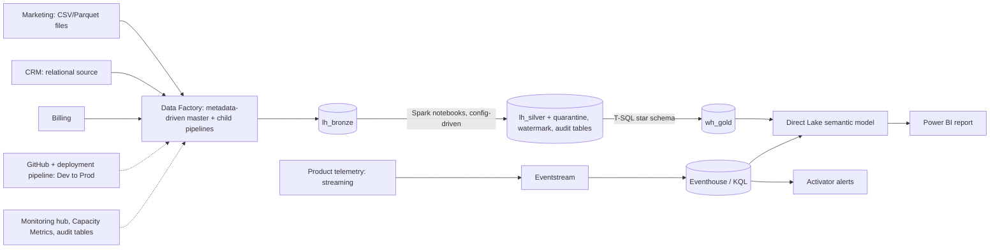

# Architecture

Medallion lakehouse (bronze, silver, gold) with a warehouse serving layer, a real-time path through
Eventstream and Eventhouse, and a Direct Lake semantic model.

## Target components
- Workspaces: dev and prod, connected to Git, joined by a deployment pipeline
- Bronze lakehouse, silver lakehouse, gold warehouse
- Data Factory pipelines: one master orchestrator plus child pipelines
- Spark notebooks (PySpark and Spark SQL) with a shared, config-driven framework
- Eventstream, Eventhouse (KQL database), Activator alerts
- Semantic model (Direct Lake) and Power BI report
- Monitoring: Monitoring hub, Capacity Metrics app, audit tables

## Table inventory (targets)
- Bronze (about 8): campaigns, ad_spend, web_sessions, crm_accounts, crm_contacts, crm_opportunities,
  billing_subscriptions, billing_invoice_lines, plus raw usage events
- Silver (about 8 to 10): cleaned versions of the above, a quarantine table, a watermark control table,
  a pipeline audit table
- Gold (about 10): facts for subscription revenue, pipeline, marketing spend, product usage; dimensions for
  account (type 2), date, region, campaign, product, sales rep
- Real-time (1 to 2): trial signup events, usage events in the Eventhouse
